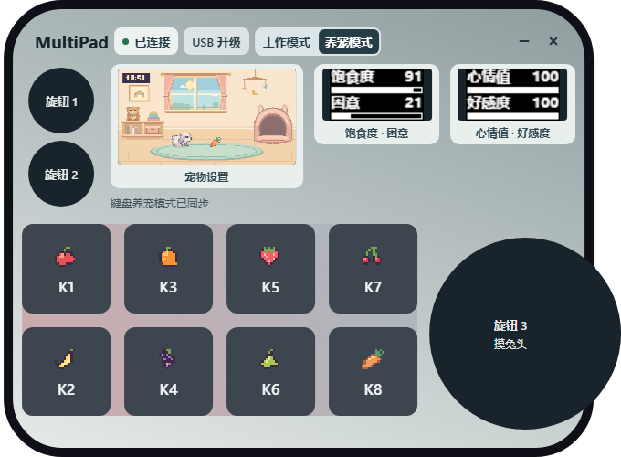
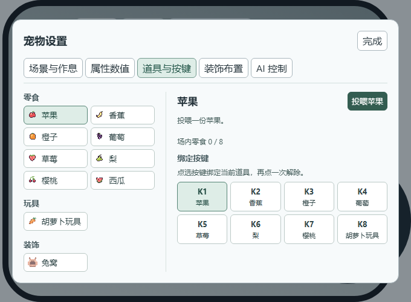
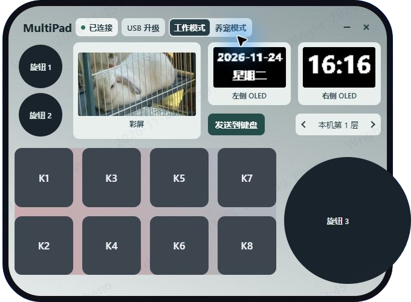
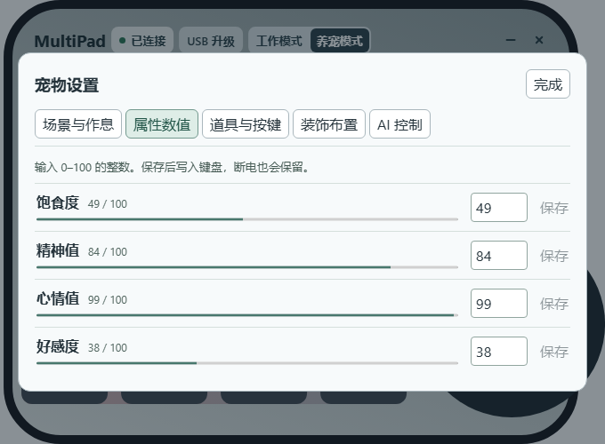

# MultiPad

[简体中文](README.md) · **English**

MultiPad is a programmable desktop keypad with eight keys, three rotary encoders, a color display and two OLEDs. Use it for shortcuts and PC monitoring in Work mode, then switch to Pet mode to look after a lop-eared rabbit. The rabbit runs on the keyboard. The Windows app lets you arrange its room, bind treats to keys and optionally connect an AI model to direct its behavior.



## Try it

1. Install the Windows x64 app and connect a compatible MultiPad with a USB data cable. If the keyboard already has the MultiPad USB bootloader, select **USB 升级** (USB update) and choose the matching application firmware `.bin`. For first-time flashing and recovery, see the [USB firmware guide, in Chinese](docs/usb-firmware-update.md).
2. Select **工作模式** (Work). Click a virtual key to configure it, the color display to choose an image or PC performance monitor, or an OLED to configure its content. The monitor can show CPU, memory and system drive usage.
3. Select **养宠模式** (Pet), click the color display and open **道具与按键** (Items and keys). Select an apple and bind it to K1. Press K1 on the keyboard or click K1 in the app. The apple drops into the room and the rabbit approaches it when hungry.



## Hardware design and enclosure

The original schematics and PCB layouts were published by iLx11. Open the Design Files section of the upstream project for the EasyEDA Pro design. [Original hardware project](https://oshwhub.com/ilx1/multi-pad#1)

| PCB revision | Display connection | Enclosure fit |
| --- | --- | --- |
| FPC | The LCD and OLEDs connect via flexible flat cables | Fits the front and rear shells designed for the FPC revision |
| Module | Uses display modules | Can reuse the FPC rear shell and requires a front shell adapted to the module board |

See the author's [enclosure assembly video](https://www.bilibili.com/video/BV1rw6aYAEAK/) for the enclosure layout and installation steps.

## Work mode

Select **工作模式** (Work) at the top of the Windows app. You can also hold the large encoder on the keypad for about 1.2 seconds to switch modes. When leaving Pet mode, hold it without turning, then release.



| Control | What to configure |
| --- | --- |
| K1–K8 and the three encoders | Click a key or encoder in the app to assign a shortcut, key sequence with delays, text, file or app launch, media control, or mouse action. Encoder presses and turns can have separate assignments. |
| Configuration layers | Use the arrows beside **本机第 N 层** (Local layer N) to edit up to 10 layers. Assign **菜单控制** (Menu control) to a physical key to go to the previous, next, or a specific layer. For example, keep office and video-editing shortcuts on separate layers. |
| Color display | Choose an image or **电脑性能监测** (PC performance monitor) for CPU, memory, and system drive usage. |
| Two OLEDs | Configure each display for the current layer with an image, custom text, time, date, date and time, or API data. |

Click **发送到键盘** (Send to keypad) to transfer the enabled layers and their display settings over USB. Live PC metrics and dynamic OLED updates require the Windows app to stay connected over USB and compatible firmware.

## Living with the rabbit

| Control | What it does |
| --- | --- |
| Click the color display | Open pet settings. Move the hutch under **装饰布置** (Decorations), or enable **跟随现实时间** to sync the scene clock with the PC. |
| Click either OLED | Pick two parameters for that display. Pet stats have a label, a number and a progress bar. |
| Press the large encoder | Pet the rabbit. Hold and turn to stroke its head. Hold still for about 1.2 seconds and release to leave Pet mode. |
| Turn the small encoders | The left encoder changes the time. The right changes the season. Hold and turn the right encoder to switch between garden and nursery. |
| Press a bound item key | Drop a snack or place a toy. Press the toy key again to pick it up. Each scene holds one toy and up to eight snacks. |

The rabbit eats snacks one at a time, returns to its hutch to sleep and sometimes stands up to look around. A happier rabbit is more likely to leap, kick in midair and land facing the other way. The nursery window changes from sunlight to moonlight with the scene clock.

## Adjust a stat

In Pet mode, click the color display, then **属性数值** (Stat values). Enter a whole number from 0 to 100 and click **保存** (Save) on that row. You can change fullness, energy, mood or affection. Higher energy means the rabbit is more rested. Sleep restores energy. Walking and vigorous movement consume both fullness and energy. Older saves retain their equivalent energy level. The keyboard confirms the value and saves it in flash. Edits made while disconnected only affect the local preview. Manual editing requires pet protocol generation 10 or later.



Stats continue to change during Pet mode. With sustained good care, affection rises. When the rabbit stays hungry, unhappy or overtired, affection decreases. Powering the keyboard off pauses the simulation and preserves saved stats. After five minutes without owner interaction, each stat drops by one point every two minutes until the next interaction. The rabbit naturally daydreams between walks for about 15 seconds and can gaze at its owner for about eight seconds.

## Optional AI control

Open **AI 控制** (AI control) in pet settings. Enter the base URL, model name and key for an OpenAI-compatible API that supports tool calls. The included Alibaba Cloud Beijing Token Plan endpoint requires a Token Plan key. Choose a Token Plan model or enter a custom model name. Head strokes, feeding, and toy placement trigger an immediate decision and cancel the remaining idle plan. A continuous stroke produces one response, executed after you let go. During quiet periods the model plans a variable-length sequence about once a minute. Longer sequences can finish before the next round. The app checks the keyboard before each action, waits briefly when the rabbit is busy, and skips individual ineligible actions. The owner controls food, toys and scene changes. [MCP tools and events, in Chinese](docs/pet-mcp.md)

## Build from source

- **Windows app** — In `app/`, run `pnpm install`, then `pnpm start` for development or `pnpm electron:build` for a Windows installer. The app uses Electron and Vue.
- **USB application firmware** — Install Arm GNU Embedded Toolchain 10.3-2021.10, CMake 3.28.1 and Ninja. With those tools on your PATH, run the following from the repository root.

```sh
cmake -S firmware -B out/usb-app -G Ninja -DCMAKE_BUILD_TYPE=Debug -DMULTIPAD_IMAGE=usb-app
cmake --build out/usb-app
```

The file to select in the Windows updater is `out/usb-app/leden.bin`. The bootloader and standalone images use different flash layouts. [Screen readback design, in Chinese](docs/screen-readback.md)

## Credits and license

The Windows app is based on [iLx11/key-pad-application](https://github.com/iLx11/key-pad-application) and the STM32F103VETx firmware on [iLx11/multi-pad](https://github.com/iLx11/multi-pad). This repository retains the upstream history and [GPL-3.0 license](LICENSE).
