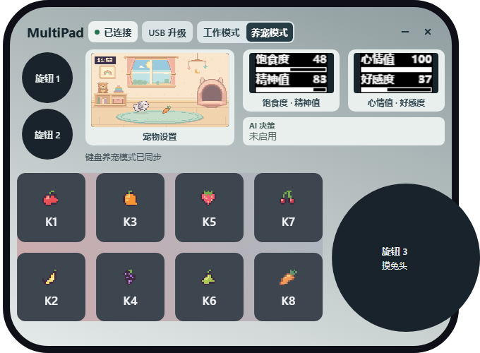
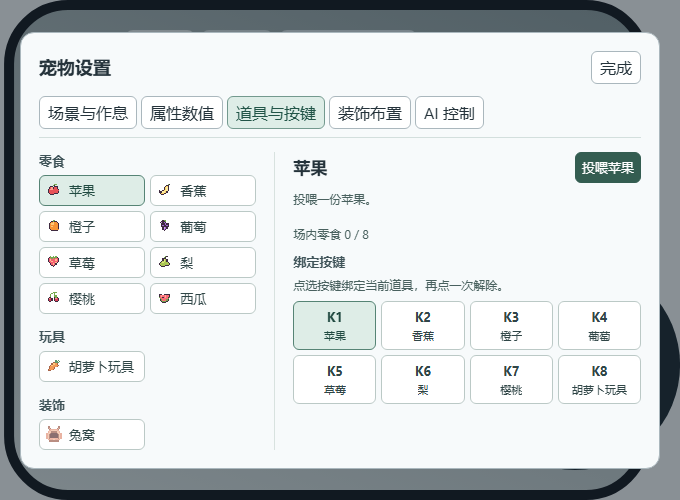
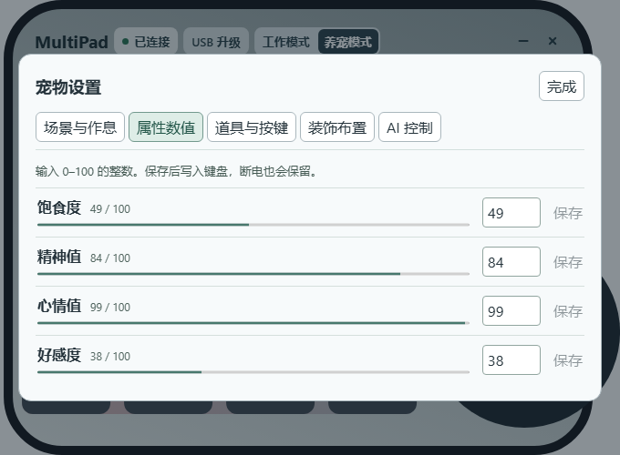

# MultiPad 效率键盘

**简体中文** · [English](README.en.md)

MultiPad 是一块带 8 个可编程按键、3 个旋钮、一块彩屏和两块 OLED 的桌面键盘。工作时可以用它跑快捷操作、看电脑负载；切到养宠模式，同一块屏幕就是一只垂耳兔的家。兔子在键盘固件里活动，通过 USB 连接 Windows 软件后，可以布置房间、调整属性，也可以让 AI 编排动作。



## 第一次使用

1. 在 Windows x64 安装 MultiPad，用 USB 数据线连接支持配套固件的键盘。已有 USB 升级引导程序的键盘，在软件里点 **USB 升级**，选择同一版本的应用固件 `.bin`。首次烧录请看[固件安装与恢复](docs/usb-firmware-update.md)。
2. 点 **工作模式**，点击虚拟键盘上的按键、彩屏或小屏进入对应设置。彩屏可以显示电脑性能，小屏可以显示时间、文字或数据。
3. 点 **养宠模式**，点击彩屏进入 **宠物设置**。在 **道具与按键** 中选一个苹果，绑定到 K1，然后按实体 K1 或点击软件上的 K1。苹果会掉进场景，兔子饿了会走过去吃。

## 仓库内容

Windows 上位机和 STM32 固件在同一仓库维护，涉及 USB 协议的改动可以在一个 PR 内同步两端。

| 目录 | 内容 | 上游基线 |
| --- | --- | --- |
| [app](app/) | Electron / Vue 上位机 | [iLx11/key-pad-application](https://github.com/iLx11/key-pad-application) · `e2844bf` |
| [firmware](firmware/) | STM32F103VETx 固件 | [iLx11/multi-pad](https://github.com/iLx11/multi-pad) · `78c1ee5` |

## 工作模式

在 Windows 软件顶部选择 **工作模式**。按住键盘的大旋钮约 1.2 秒也可以切换模式。从养宠模式退出时，按住不转，然后松开。

| 设置项 | 操作与用途 |
| --- | --- |
| K1–K8 和三个旋钮 | 点击软件首页上的按键或旋钮，给相应操作绑定快捷键、带延时的按键序列、文本、文件或应用、媒体控制、鼠标操作等。旋钮可分别配置按压和旋转动作。 |
| 配置层 | 使用 **本机第 N 层** 两侧的箭头选择要编辑的层，最多 10 层。可用 **菜单控制** 给实体按键绑定上一层、下一层或指定层。例如，为办公和剪辑各建一层，再用一个按键切换。 |
| 彩屏 | 点击彩屏，选择自定义图片或 **电脑性能监测**。性能监测显示 CPU 使用率、内存占用率和系统盘容量占用率。 |
| 两块 OLED | 点击对应小屏，为当前层分别设置图片、自定义文字、时间、日期、时间和日期，或 API 数据。 |

配置好后，在主界面点 **发送到键盘**，通过 USB 将已启用的配置层及其屏幕设置写入键盘。实时性能监测和动态 OLED 刷新需要 Windows 软件保持 USB 连接，并使用配套固件。

## 养宠模式

点击软件顶部的 **养宠模式** 进入，再点彩屏打开宠物设置。在「道具与按键」里可把零食或玩具绑定到 K1–K8，主页按键会显示对应图标。点击虚拟按键和按下实体键都能投放道具。同一场景可放一件玩具，再按一次收回。每个场景最多可落下八份水果，兔子逐份吃，吃饱后会留下余粮。



宝宝房的兔窝是互动装饰，可以和胡萝卜玩具同时摆放。在宠物设置的「装饰布置」中拖动兔窝，松开后键盘会保存位置。兔子可以进去小憩，睡觉时也会回到这里。

### 查看和调整属性

进入 **宠物设置 → 属性数值**，为饱食度、精神值、心情值或好感度输入 0–100 的整数，点该行的 **保存**。连接键盘时，以键盘回读的数值为准，确认后保存在 Flash；未连接时可试调本机预览。手动设置需要支持第 10 代养宠协议的配套固件。睡眠恢复精神值，散步和跑跳会额外消耗饱食度与精神值。旧档自动按「100 − 原困意」换算。



点击任一小屏可为它选择两项参数。饱食度、精神值、心情值和好感度都显示名称、数值和进度条。养宠时短按大旋钮（旋钮 3）可以摸兔头，按住向左或向右转可以来回抚摸。手的位置跟着转过的格数变化，停转时手停住。抚摸期间兔子停在原地，松手后继续原来的活动。软件上也可点击旋钮 3，或按住它拖转、滚动鼠标滚轮。需要退出养宠时，按住大旋钮约 1.2 秒，保持不转再松手。

左上小旋钮调时间，右上小旋钮调季节，按住右上小旋钮旋转可切换花园和宝宝房。宠物设置中的「跟随现实时间」会把场景时钟与电脑对齐。

键盘彩屏性能监测、软件控制宠物和小屏动态刷新需要配套固件及 USB。切回工作模式后，OLED 恢复该菜单下的工作内容。

### 可选的 AI 控制

养宠模式下，点击软件彩屏，进入 **宠物设置 → AI 控制**。填写支持工具调用的 OpenAI 兼容 API 地址、模型名和 API Key，默认预填百炼北京 Token Plan 地址及 qwen3.8-flash，使用该地址时请填写 Token Plan 专用 Key。可以在「兔子的角色设定」里调整性格和动作偏好。保存后可测试连接和实机眨眼动作。启用自主动作后，摸头、投喂或放玩具会让模型根据键盘的最新状态安排兔子的身体动作，道具由主人操作。连续转旋钮摸头合为一次，停手后再决定。没有互动时，每轮结束 60 秒后再做下一次决定。[MCP 工具与事件](docs/pet-mcp.md)

饱食度、精神值、心情值和好感度保存在键盘的 Flash。键盘通电且处于养宠模式时会继续更新属性，重新上电后读取最近一次校验成功的记录。断电期间时间暂停。

## 本地构建

- 上位机在 `app/` 运行 `pnpm install` 后，可用 `pnpm start` 启动开发窗口，或用 `pnpm electron:build` 打包。仓库导入前，本机已成功打包 Windows x64 并连接实机。上游 TypeScript 全量检查仍有历史报错。
- 固件在 `firmware/` 使用 Arm GNU Embedded Toolchain 10.3-2021.10、CMake 3.28.1 和 Ninja。将工具加入当前终端的 PATH，在仓库根目录运行：

  ```sh
  cmake -S firmware -B out/firmware -G Ninja -DCMAKE_BUILD_TYPE=Debug
  cmake --build out/firmware
  ```

  编译会生成 `leden.elf`、`leden.hex` 和 `leden.bin`。以上命令使用默认固件布局；制作软件「USB 升级」可用的应用固件时，配置阶段需加 `-DMULTIPAD_IMAGE=usb-app`。

## 维护

- 建议用功能分支和 PR 合并到 `main`。跨端改动记录协议版本和验证过的设备。
- 从 Git Tag 发布。上位机可以用 `app-v*`，固件可以用 `fw-v*`。协议相关 Release 在说明里链接配套版本，附对应构建产物和实机验证结果。
- 原作者的历史和 [GPL-3.0 许可证](LICENSE)保留。分发二进制时提供对应源码和构建脚本。
- [屏幕回读设计](docs/screen-readback.md)。
- [桌宠 MCP 接入说明](docs/pet-mcp.md)。
